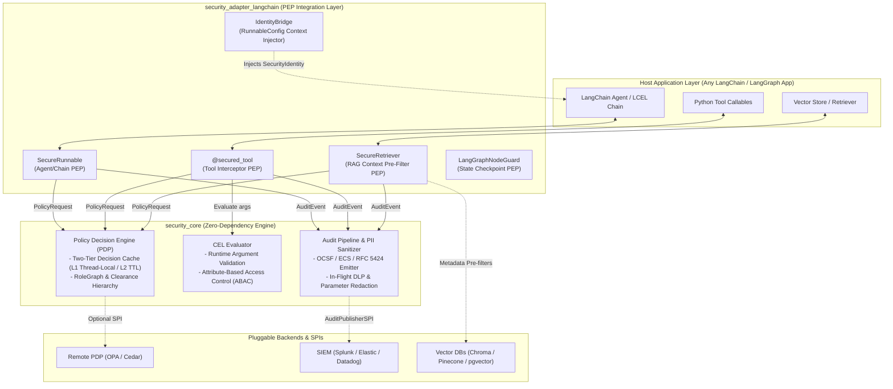
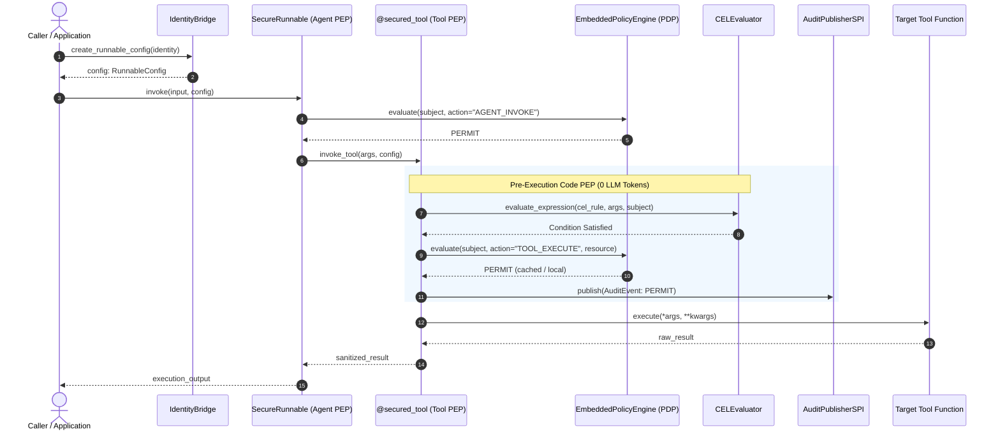

# LangChain Security Extension

[](https://pypi.org/project/langchain-security-extension/)
[](https://prashantdev.github.io/langchain-security-extension/)
[](LICENSE)
[](https://github.com/prashantdev/langchain-security-extension/actions)
[](src/security_core)
[](https://python.langchain.com/)

> **Quick Intro:** This library provides deterministic, code-level Policy Enforcement Points (PEPs) for LangChain and LangGraph agents—shifting organizations from fragile, prompt-dependent guardrails to deterministic, enterprise-grade governance.
>
> 📖 **[Read the Enterprise Implementation Guide](https://prashantdev.github.io/langchain-security-extension/)** for step-by-step architecture patterns, policy authoring, and production rollout instructions.

### ✨ Strategic Advantages

* **Hard Cost Protection & FinOps Control:** Enforces a *Zero-Token Denial Principle* that stops unentitled requests at the front door before prompts are serialized or tokens are billed, while retry budgets shut down runaway agent loops.
* **Deterministic Governance Over "Prompt Hopes":** Never trusts the LLM to police itself. Security parameters, roles, and tenant IDs are stripped from model schemas (**Schema Hiding**), making it impossible for agents to inspect, hallucinate, or forge security context.
* **Frictionless IT & Identity Integration:** Preserves existing investments in Okta, Microsoft Entra ID, Keycloak, and Open Policy Agent (OPA), propagating caller context deterministically through LangChain's `RunnableConfig`.
* **Single-Point Regulatory Compliance (GDPR, HIPAA, PCI-DSS):** Centralizes Data Loss Prevention (DLP) to automatically mask PII, credentials, and payment card numbers (via Luhn validation) across prompts, RAG chunks, tool arguments, and logs.
* **Non-Blocking, Auditor-Ready Observability:** Streams structured telemetry (OCSF, ECS, and RFC 5424) with W3C distributed tracing over an asynchronous ring buffer that never stalls or crashes agent workflows.

---

## 📦 Installation

Install the core engine

```bash
pip install langchain-security-extension
```

---

## ⚡ Quickstart

Wrap any tool callable with deterministic CEL (Common Expression Language) parameter constraints, clearance floors, and RBAC/ABAC. Caller identity travels in-band across all agent steps via LangChain's native `RunnableConfig`—with **zero LLM prompt overhead**:

```python
from security_adapter_langchain import secured_tool
from security_core import IdentityBridge, SecurityIdentity, ToolExecutionDeniedError

# 1. Protect any tool with deterministic CEL argument constraints
@secured_tool(
    required_roles=["DEVOPS"],
    min_clearance=1,
    cel_expression="args.server.startsWith('prod-') ? subject.dept == 'INFRA' : true",
    is_mutative=True
)
def example_tool_op_reboot_server(server: str) -> str:
    return f"Rebooted {server}"

# Helper: attach identity to LangChain RunnableConfig
def caller(dept: str):
    return IdentityBridge.create_runnable_config(
        SecurityIdentity.create("alice", "CORP", {"DEVOPS"}, 1, dept)
    )

# 2. Authorized caller (DEVOPS + INFRA) -> PERMIT
print(example_tool_op_reboot_server("prod-db-01", config=caller("INFRA")))
# Output: "Rebooted prod-db-01"

# 3. Unauthorized caller (DEVOPS + MARKETING) -> Hard-aborted with 0 LLM tokens!
# example_tool_op_reboot_server("prod-db-01", config=caller("MARKETING"))
# Raises: ToolExecutionDeniedError (PARAMETER_CONSTRAINT_FAILED)
```

<details>
<summary><b>🔍 Folded View: Full Exception Handling & Audit Events</b></summary>

```python
try:
    example_tool_op_reboot_server("prod-db-01", config=caller("MARKETING"))
except ToolExecutionDeniedError as e:
    # Intercepted in Python bytecode before target function or LLM can run
    print(f"Blocked by Policy: {e}")
    print(f"Diagnostic Reason: {e.diagnostic_reason}")

# Under the hood, a structured audit event (OCSF / ECS / RFC 5424) is emitted to your SIEM:
# {
#   "action": "TOOL_EXECUTE",
#   "resource": "example_tool_op_reboot_server",
#   "decision": "HARD_ABORT",
#   "reason_code": "PARAMETER_CONSTRAINT_FAILED"
# }
```
</details>

---

## 🛑 The Problem: Why Prompt Guardrails Are Not Security

| Vulnerability Vector | Prompt-Based Guardrails (e.g. Llama Guard, NeMo) | `langchain-security-extension` (Code-Level PEPs) |
|---|---|---|
| **Determinism** | ❌ Stochastic (bypassed via jailbreaks & indirect prompt injection) | ✅ **100% Deterministic** (enforced in Python bytecode before tool invocation) |
| **Token Cost** | ❌ Adds 200–1,500 tokens *per turn* + recursive retry token burn | ✅ **0 LLM Tokens** (front-door denial + invocation retry budgets) |
| **Context Forgery** | ❌ Security parameters exposed in tool JSON schemas can be hallucinated | ✅ **Schema Hiding** strips security attributes before model binding |
| **Argument Validation** | ❌ Cannot reliably validate dynamic args (e.g. CIDR blocks, hostnames) | ✅ **CEL Expressions** evaluate tool arguments against live subject attributes |
| **Data Retrieval (RAG)** | ❌ Post-retrieval filtering causes cross-tenant leaks or result starvation | ✅ **Native DB Pre-Filters** + signed `sec:*` chunk envelopes & oversampling |
| **Data Privacy (DLP)** | ❌ Scattered manual regex hooks prone to developer oversight | ✅ **Single-Point DLP** masks PII, secrets, and payment cards in-flight |
| **Compliance & SIEM** | ❌ Synchronous or unstructured logs that stall agents or fail audits | ✅ **Async Ring Buffer** streaming OCSF, ECS, and RFC 5424 audit events |

---

## 🧩 Core Capabilities

### 1. [`@secured_tool`](src/security_adapter_langchain/tool_decorator.py) — Pre-Execution Tool Guardrails
Defend critical infrastructure and APIs against prompt-injection tool hijacking. Evaluates Common Expression Language (CEL) rules against the live caller identity and tool arguments before execution starts:

```python
from security_adapter_langchain import secured_tool

@secured_tool(
    required_roles=["ADMIN", "DEVOPS"],
    min_clearance=3,
    cel_expression="entities.server[args.server_name].ownerDepartment == subject.dept || subject.clearance >= 3",
    is_mutative=True,
    masked_params=["password", "secret", "api_key"]
)
def flush_database_cache(server_name: str, flush_level: str) -> str:
    """Flush cache on designated server cluster."""
    return f"Cache flushed on {server_name}."
```

### 2. [`SecureRunnable`](src/security_adapter_langchain/runnable_guard.py) — Agent Boundary Access Gate
Guard agent entrypoints and enforce multi-tenant isolation boundaries in LangChain LCEL workflows:

```python
from security_adapter_langchain import SecureRunnable
from security_core import EmbeddedPolicyEngine

pdp = EmbeddedPolicyEngine.create()

secured_remediation_agent = SecureRunnable.wrap(
    runnable=remediation_agent_executor,
    pdp_engine=pdp,
    agent_name="remediation-agent",
    required_roles=["TIER2_SUPPORT"],
    min_clearance=2,
    target_tenant="CORP_MAIN"
)
```

### 3. [`SecureRetriever`](src/security_adapter_langchain/retriever_wrapper.py) — Knowledge Base & RAG Pre-Filtering
Stop context window leakage of unauthorized documents. Applies vector database pre-filters, verifies signed `sec:*` metadata envelopes, and performs post-retrieval clearance pruning:

```python
from security_adapter_langchain import SecureRetriever

secure_retriever = SecureRetriever.wrap(
    retriever=chroma_store.as_retriever(),
    pdp_engine=pdp,
    document_namespace="it_runbooks"
)
```

### 4. Zero-Dependency Core & High Performance
The core policy evaluation engine (`security_core`) has **zero external runtime dependencies** (pure standard library + `typing-extensions`), sub-millisecond evaluation times, and two-tier L1/L2 decision caching.

---

## 🏗️ Architecture & Enforcement Lifecycle

The framework implements a distributed **Zero-Trust Policy Enforcement Architecture** aligned with **NIST SP 800-207**. The core policy decision engine is strictly separated from the LangChain orchestration layer, ensuring security evaluation executes independently of model prompts.

### Modular Layered Architecture



### NIST SP 800-207 Zero-Trust PEP / PDP Mapping

| Zero-Trust Role | Library Component | Implementation Responsibilities |
|---|---|---|
| **PEP**<br/>(Policy Enforcement Point) | [`@secured_tool`](src/security_adapter_langchain/tool_decorator.py)<br/>[`SecureRunnable`](src/security_adapter_langchain/runnable_guard.py)<br/>[`SecureRetriever`](src/security_adapter_langchain/retriever_wrapper.py)<br/>[`LangGraphNodeGuard`](src/security_adapter_langchain/langgraph_integration.py) | • Intercepts execution requests before tool/chain execution.<br/>• Enforces caller role and clearance floors.<br/>• Applies vector DB metadata pre-filters and prunes documents.<br/>• Emits immutable structured audit events to SIEM. |
| **PDP**<br/>(Policy Decision Point) | [`EmbeddedPolicyEngine`](src/security_core/pdp.py)<br/>[`RemoteOpaAdapter`](src/security_pdp_opa/opa_adapter.py) | • Evaluates authorization requests deterministically.<br/>• Manages two-tier decision caching (L1 thread-local, L2 LRU TTL).<br/>• Resolves hierarchical role graphs and multi-tenant isolation.<br/>• Evaluates fail-closed / fail-open circuit breakers on remote PDP outages. |
| **PIP**<br/>(Policy Information Point) | [`IdentityBridge`](src/security_core/identity.py)<br/>[`EntityAttributeResolverSPI`](src/security_core/registry.py) | • Converts inbound JWT/OAuth claims into immutable `SecurityIdentity`.<br/>• Injects identity into LangChain's native `RunnableConfig`.<br/>• Resolves dynamic entity attributes (e.g. server owner, user dept) for CEL rules. |
| **PAP**<br/>(Policy Administration Point) | Declarative Decorators & CEL Expressions | • Declarative `@secured_tool` parameters (`required_roles`, `min_clearance`).<br/>• Common Expression Language rules evaluated over live arguments.<br/>• Metadata classification schemas (`sec.clearance`, `sec.department`). |

### PEP Interception Lifecycle



---

## 📖 Enterprise Implementation Guide & Reference App

Ready to adopt `langchain-security-extension` in your organization?

1. 📘 **[Enterprise Implementation Guide](https://prashantdev.github.io/langchain-security-extension/)**  
   The complete guide to rolling out deterministic security in production—covering Identity Provider (IdP) wiring, CEL & OPA policy authoring, RAG metadata signing, DLP sanitization, and SIEM telemetry.

2. 🧪 **[Companion Reference Application: Enterprise IT Incident Assistant](https://github.com/prashantdev/langchain-enterprise-incident-assistant)**  
   The live demonstrator codebase used throughout the implementation guide to illustrate a real-world migration from fragile prompt guardrails to deterministic enforcement:
   - **Unhardened baseline (`master` branch):** Demonstrates real prompt injection vulnerabilities, bypassing standard LLM system prompts and causing unauthorized tool calls.
   - **Hardened implementation (`secured3` branch):** Shows the complete, production-grade integration of `langchain-security-extension` following the implementation guide.
   - **Automated verification suites:** Run `./run-security-suite.sh --suite basic` and `./run-security-suite.sh --suite guardrail` to verify defenses and audit streaming in action.

---

## 📄 License

This project is licensed under the [Apache License 2.0](LICENSE).
