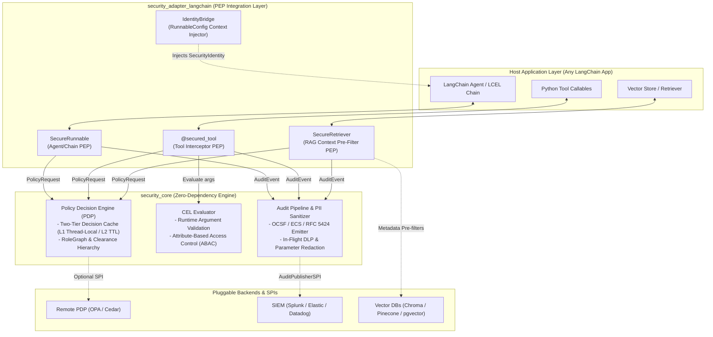
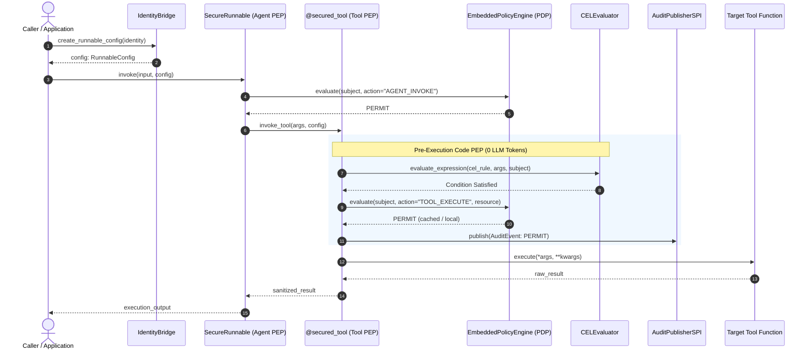

# LangChain Security Extension Documentation

[](https://pypi.org/project/langchain-security-extension/)
[](https://github.com/prashantdev/langchain-security-extension/blob/main/LICENSE)
[](https://github.com/prashantdev/langchain-security-extension/tree/main/src/langchain_security_extension/security_core)
[](https://python.langchain.com/)

> **Deterministic, Zero-Trust Policy Enforcement Points (PEPs) for LangChain Agents**  
> Shift your enterprise AI from fragile, prompt-dependent guardrails to deterministic, code-level governance.

---

## 🗺️ Documentation Portal

This documentation portal provides architectural blueprints, step-by-step rollout guides, and module specifications for securing enterprise LLM applications.

| Documentation Resource | Description | Destination |
|---|---|---|
| 📘 **Enterprise Implementation Guide** | 12-chapter comprehensive walkthrough using a real-world enterprise incident assistant to demonstrate hardening from scratch. | [Open Implementation Guide](guides/index.html) |
| 📚 **API Reference** | Complete module specifications for `security_core`, `security_adapter_langchain`, and `security_pdp_opa`. | [Browse API Reference](api/index.html) |
| 🧪 **Companion Reference Application** | Working FastAPI + LangChain demonstrator application illustrating baseline vulnerabilities (`master`) vs hardened controls (`secured`). | [View on GitHub](https://github.com/prashantdev/langchain-enterprise-incident-assistant) |
| 💻 **Source Code Repository** | Core library repository, Installation instructions, issue tracker, and contribution guidelines. | [GitHub Repository](https://github.com/prashantdev/langchain-security-extension) |

---

## ⚡ Quickstart

Protect tool calls with Common Expression Language (CEL) argument constraints, caller role checks, and numeric clearance levels. Identity context propagates deterministically in-band via LangChain's native `RunnableConfig` without prompt overhead:

```python
from langchain_security_extension.security_adapter_langchain import secured_tool
from langchain_security_extension.security_core import IdentityBridge, SecurityIdentity, ToolExecutionDeniedError


# 1. Protect any tool with deterministic CEL argument constraints
@secured_tool(
    required_roles=["DEVOPS"],
    min_clearance=1,
    cel_expression="args.server.startsWith('prod-') ? subject.dept == 'INFRA' : true",
    is_mutative=True
)
def example_tool_op_reboot_server(server: str) -> str:
    return f"Rebooted {server}"


# Helper: attach identity to LangChain RunnableConfig
def caller(dept: str):
    return IdentityBridge.create_runnable_config(
        SecurityIdentity.create("alice", "CORP", {"DEVOPS"}, 1, dept)
    )


# 2. Authorized caller (DEVOPS + INFRA) -> PERMIT
print(example_tool_op_reboot_server("prod-db-01", config=caller("INFRA")))
# Output: "Rebooted prod-db-01"

# 3. Unauthorized caller (DEVOPS + MARKETING) -> Hard-aborted with 0 LLM tokens!
# example_tool_op_reboot_server("prod-db-01", config=caller("MARKETING"))
# Raises: ToolExecutionDeniedError (PARAMETER_CONSTRAINT_FAILED)
```

---

## 🛑 The Problem: Why Prompt Guardrails Are Not Security

| Vulnerability Vector | Prompt-Based Guardrails (e.g. Llama Guard, NeMo) | `langchain-security-extension` (Code-Level PEPs) |
|---|---|---|
| **Determinism** | ❌ Stochastic (bypassed via jailbreaks & indirect prompt injection) | ✅ **100% Deterministic** (enforced in Python bytecode before tool invocation) |
| **Token Cost** | ❌ Adds 200–1,500 tokens *per turn* + recursive retry token burn | ✅ **0 LLM Tokens** (front-door denial + invocation retry budgets) |
| **Context Forgery** | ❌ Security parameters exposed in tool JSON schemas can be hallucinated | ✅ **Schema Hiding** strips security attributes before model binding |
| **Argument Validation** | ❌ Cannot reliably validate dynamic args (e.g. CIDR blocks, hostnames) | ✅ **CEL Expressions** evaluate tool arguments against live subject attributes |
| **Data Retrieval (RAG)** | ❌ Post-retrieval filtering causes cross-tenant leaks or result starvation | ✅ **Native DB Pre-Filters** + signed `sec:*` chunk envelopes & oversampling |
| **Data Privacy (DLP)** | ❌ Scattered manual regex hooks prone to developer oversight | ✅ **Single-Point DLP** masks PII, secrets, and payment cards in-flight |
| **Compliance & SIEM** | ❌ Synchronous or unstructured logs that stall agents or fail audits | ✅ **Async Ring Buffer** streaming OCSF, ECS, and RFC 5424 audit events |

---

## 🏗️ Architecture & Enforcement Lifecycle

The framework implements a distributed **Zero-Trust Policy Enforcement Architecture** aligned with **NIST SP 800-207**. The core policy decision engine is strictly separated from the LangChain orchestration layer, ensuring security evaluation executes independently of model prompts.

### Modular Layered Architecture



### NIST SP 800-207 Zero-Trust PEP / PDP Mapping

| Zero-Trust Role | Library Component | Implementation Responsibilities |
|---|---|---|
| **PEP**<br/>(Policy Enforcement Point) | [`@secured_tool`](api/langchain_security_extension/security_adapter_langchain.html#secured_tool)<br/>[`SecureRunnable`](api/langchain_security_extension/security_adapter_langchain.html#SecureRunnable)<br/>[`SecureRetriever`](api/langchain_security_extension/security_adapter_langchain.html#SecureRetriever) | • Intercepts execution requests before tool/chain execution.<br/>• Enforces caller role and clearance floors.<br/>• Applies vector DB metadata pre-filters and prunes documents.<br/>• Emits immutable structured audit events to SIEM. |
| **PDP**<br/>(Policy Decision Point) | [`EmbeddedPolicyEngine`](api/langchain_security_extension/security_core.html#EmbeddedPolicyEngine)<br/>[`RemotePDPAdapter`](api/langchain_security_extension/security_pdp_opa.html#RemotePDPAdapter) | • Evaluates authorization requests deterministically.<br/>• Manages two-tier decision caching (L1 thread-local, L2 LRU TTL).<br/>• Resolves hierarchical role graphs and multi-tenant isolation.<br/>• Evaluates fail-closed / fail-open circuit breakers on remote PDP outages. |
| **PIP**<br/>(Policy Information Point) | [`IdentityBridge`](api/langchain_security_extension/security_core.html#IdentityBridge)<br/>[`EntityAttributeResolverSPI`](api/langchain_security_extension/security_core.html#EntityAttributeResolverSPI) | • Converts inbound JWT/OAuth claims into immutable `SecurityIdentity`.<br/>• Injects identity into LangChain's native `RunnableConfig`.<br/>• Resolves dynamic entity attributes (e.g. server owner, user dept) for CEL rules. |
| **PAP**<br/>(Policy Administration Point) | Declarative Decorators & CEL Expressions | • Declarative `@secured_tool` parameters (`required_roles`, `min_clearance`).<br/>• Common Expression Language rules evaluated over live arguments.<br/>• Metadata classification schemas (`sec.clearance`, `sec.department`). |

### PEP Interception Lifecycle



---

## 📖 Implementation Guide Overview

The [Enterprise Implementation Guide](guides/index.html) covers end-to-end integration across 12 focused chapters:

1. [Architecture Blueprint & System Boundaries](guides/1.%20Architecture%20Blueprint%20&%20System%20Boundaries.html)
2. [Connecting Your Identity Provider](guides/2.%20Connecting%20Your%20Identity%20Provider.html)
3. [Setting Up Your Authorization Engine](guides/3.Setting%20Up%20Your%20Authorization%20Engine.html)
4. [Protecting Agents and Execution Entry Points](guides/4.%20Protecting%20Agents%20and%20Execution%20Entry%20Points.html)
5. [Security Labeling and Admission Control in the Ingestion Pipeline](guides/5.%20Security%20Labeling%20and%20Admission%20Control%20in%20the%20Ingestion%20Pipeline.html)
6. [Integrating Your Vector Database](guides/6.%20Integrating%20Your%20Vector%20Database.html)
7. [Guarding Tools and Enterprise APIs](guides/7.%20Guarding%20Tools%20and%20Enterprise%20APIs.html)
8. [Defending Against Agent Looping](guides/8.%20Defending%20Against%20Agent%20Looping.html)
9. [Sanitizing Sensitive Payloads](guides/9.%20Sanitizing%20Sensitive%20Payloads.html)
10. [Connecting to Enterprise SIEM and Log Aggregators](guides/10.%20Connecting%20to%20Enterprise%20SIEM%20and%20Log%20Aggregators.html)
11. [Enforcing Multi-Tenancy](guides/11.%20Enforcing%20Multi-Tenancy.html)
12. [Troubleshooting & Diagnostics](guides/12.Troubleshooting.html)
